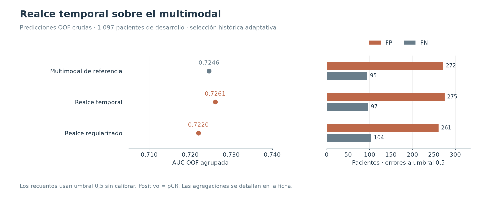
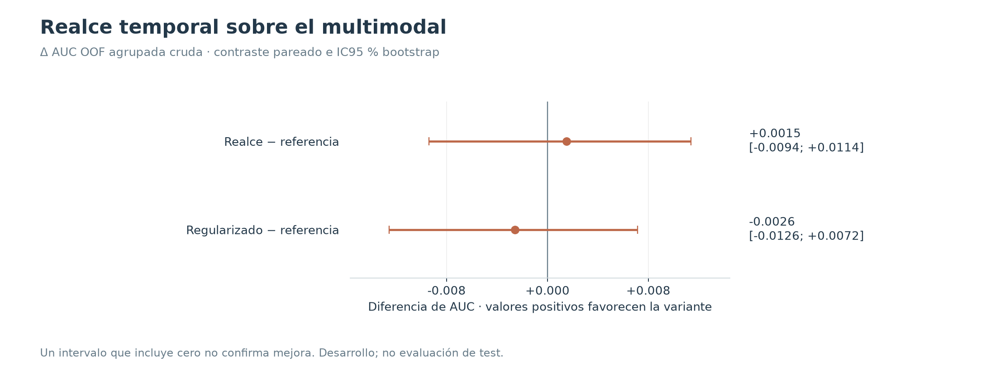

# Realce temporal sobre el multimodal

**10/10/2026 · Descartado por no demostrar una mejora útil.** Se conservó el multimodal de referencia de aquel momento; este registro no cambia el modelo vigente del proyecto.

## Hipótesis y diseño

Añadir EARLY−PRE, LATE−PRE y LATE−EARLY a las tres fases podía facilitar el aprendizaje del realce. Se probaron la variante básica y otra con mayor regularización (dropout 0,45, dropout espacial 0,10 y weight decay 0,003). Ambas mantuvieron edad, volumen, HR y HER2 como entradas clínicas.

Se completaron 20 entrenamientos: dos variantes × dos semillas (42 y 2026) × cinco folds. El multimodal previo se reutilizó. Se compararon las mismas 1.097 pacientes de desarrollo (322 pCR). La referencia agrega cortes por mediana y las variantes de esta tabla por media.

## Resultados

| Variante | AUC OOF cruda | AUC media folds | AP cruda | Brier crudo | FP a 0,5 | FN a 0,5 |
|---|---:|---:|---:|---:|---:|---:|
| Multimodal de referencia | 0.7246 | 0.7243 | 0.5316 | 0.2109 | 272 | 95 |
| Realce temporal | 0.7261 | 0.7290 | 0.5367 | 0.2138 | 275 | 97 |
| Realce regularizado | 0.7220 | 0.7246 | 0.5242 | 0.2089 | 261 | 104 |

AUC y AP son OOF agrupadas sin calibrar; Brier, FP y FN usan probabilidades crudas y umbral 0,5. Positivo significa **pCR**, no presencia de cáncer. No son medidas de test.

La mejora puntual del realce fue +0,001519 de AUC, con tres FP y dos FN adicionales. La regularización redujo once FP a costa de nueve FN más. Los dos IC95 % de diferencia de AUC incluyen cero.

## Decisión y límites

El experimento fracasó en su objetivo de mejora; los entrenamientos terminaron correctamente. No justifica reentrenar ni sustituir los pesos conservados. Las diferencias temporales sí volvieron a estudiarse después dentro de una arquitectura distinta: [CNN multiescala](../03_cnn_cinetica_multiescala/README.md).

La selección de candidatos y checkpoints utilizó las OOF: existe optimismo de selección. Los intervalos (2.000 remuestreos por clase) condicionan a los modelos elegidos y no corrigen esa búsqueda. Tampoco se deben comparar los FP de umbrales Youden ajustados sobre las mismas OOF como si fueran una validación independiente.

## Evidencia y reproducción

- [Resultados estructurados](resultados.json) y [tabla CSV](metricas.csv), con precisión completa.
- [Procedencia y hashes SHA-256](procedencia.json) de los informes conservados en [fuentes/](fuentes/).
- Las figuras nuevas se regeneran con `python experiments/generar_figuras.py`, desde la raíz del proyecto.
- [Volver al catálogo](../README.md).
