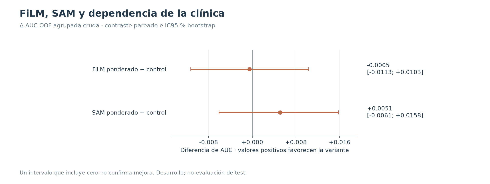
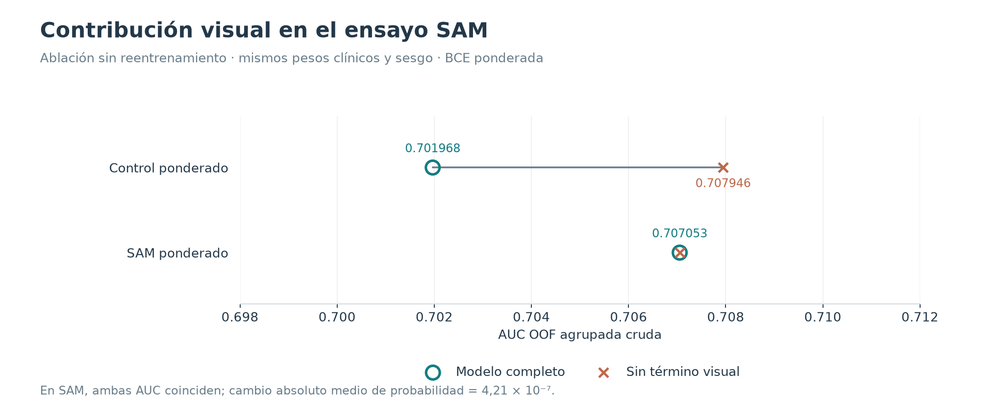

# FiLM, SAM y dependencia de la clínica

**11–12/10/2026 · Variantes descartadas.** Ninguna demostró una mejora concluyente frente a su control emparejado.

## Hipótesis y diseño

FiLM modula las características visuales con la información clínica. SAM cambia la optimización para buscar soluciones menos sensibles a perturbaciones de los pesos. Se ensayaron por separado, con BCE normal y ponderada, cinco folds y dos semillas: 40 ejecuciones registradas por estudio, incluidos sus controles.

La selección, calibración y umbrales se ajustaron dentro de cada fold y se evaluaron en su exterior. La tabla usa los controles del ensayo; la AUC 0,7246 del multimodal histórico pertenece a otro procedimiento de selección y no es su control experimental.

## Resultados

| Variante | AUC OOF cruda | Brier calibrado | FP, Youden interno | FN, Youden interno |
|---|---:|---:|---:|---:|
| Control ponderado | 0.7020 | 0.1877 | 297 | 112 |
| FiLM ponderado | 0.7014 | 0.1878 | 254 | 130 |
| SAM ponderado | 0.7071 | 0.1876 | 319 | 103 |
| Control normal | 0.6817 | 0.1894 | 311 | 104 |
| FiLM normal | 0.6718 | 0.1903 | 276 | 134 |
| SAM normal | 0.6949 | 0.1872 | 299 | 102 |

La AUC es agrupada y cruda; el Brier usa la calibración interna y los errores usan Youden interno. Cada columna mantiene su política original. Reducir FP a cambio de aumentar FN no demuestra una mejora global.

FiLM: ΔAUC −0,0005, IC95 % [−0,0113; +0,0103]. SAM: +0,0051 [−0,0061; +0,0158]. Ambos intervalos incluyen cero (2.000 remuestreos).

## Qué aportó la ablación visual

Se retiró el término visual del logit, manteniendo los pesos clínicos y el sesgo. No se reentrenó ni se sustituyeron las imágenes por imágenes negras.

En SAM ponderado la AUC quedó exactamente igual (0,707053); el cambio absoluto medio de probabilidad fue 4,21 × 10⁻⁷. En su control, retirar la imagen cambió la AUC de 0,701968 a 0,707946. Esta evidencia apunta a una contribución visual mínima en esas redes; no demuestra que toda CNN o la fusión posterior carezcan de señal visual.

## Decisión y límites

Se descartaron estas configuraciones. El resultado motivó medir la CNN por separado y estudiar una [fusión tardía](../06_fusion_tardia/README.md). La CV sigue siendo desarrollo adaptativo; los intervalos condicionan a las predicciones ya entrenadas. En estos ensayos no se cargaron imágenes de test.

## Evidencia y reproducción

- [Resultados estructurados](resultados.json) y [tabla CSV](metricas.csv), con precisión completa.
- [Procedencia y hashes SHA-256](procedencia.json) de los informes conservados en [fuentes/](fuentes/).
- Las figuras nuevas se regeneran con `python scripts/generar_figuras_experimentos.py`, desde la raíz del proyecto.
- [Volver al catálogo](../README.md).
