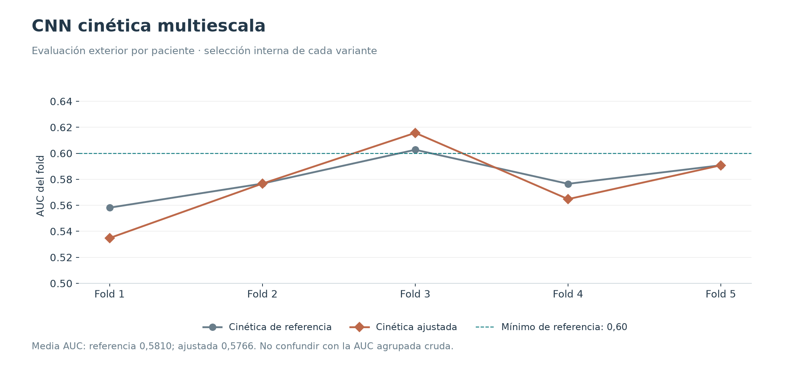

# CNN cinética multiescala

**21/10/2026 · Ajuste insuficiente.** No alcanzó el mínimo de AUC 0,60 ni el objetivo 0,70. Su arquitectura es un antecedente de la CNN actual; sus pesos y su receta no son el paquete vigente.

## Hipótesis y diseño

CNN propia sin clínica ni preentrenamiento: PRE, EARLY y LATE más tres diferencias firmadas, con vistas centrales de 256, 128 y 64 píxeles redimensionadas a 128 y un tronco compartido. La versión histórica tenía 593.521 parámetros.

Se mantuvo la arquitectura y se ajustaron tasa de aprendizaje, weight decay y pérdida. Se completaron 60 ejecuciones (tres recetas × dos pérdidas × dos semillas × cinco folds), 948 épocas, en 3 h 17 min. La elección de hiperparámetros, checkpoint, calibración y umbral fue interna; las pacientes exteriores no participaron en ella.

## Resultados

| Variante | AUC media | DE entre folds | AUC agrupada | Brier calibrado | FP, umbral interno | FN, umbral interno |
|---|---:|---:|---:|---:|---:|---:|
| Cinética de referencia | 0.5810 | 0.0168 | 0.5360 | 0.2058 | 55 | 281 |
| Cinética ajustada | 0.5766 | 0.0301 | 0.5264 | 0.2094 | 74 | 281 |

La media por fold fue 0,5766 en la ajustada frente a 0,5810 en la referencia. La AUC agrupada cruda bajó de 0,5360 a 0,5264. El informe original registra ΔAUC agrupada −0,009577, IC95 % [−0,028690; +0,008952]: no hay evidencia de mejora.

La política de máxima sensibilidad con especificidad interna ≥ 90 % produjo 74 FP y 281 FN, frente a 55 FP y 281 FN en la referencia. La sensibilidad exterior fue solo 12,73 % en ambos casos. El positivo es pCR.

## Decisión y límites

Se conservó el procedimiento seleccionado como ensayo insuficiente, sin elegir retrospectivamente el ganador de las OOF. El aprendizaje posterior se centró en [multitarea](../04_aprendizaje_multitarea/README.md) y en [muestreo y presupuesto](../05_regularizacion_y_presupuesto/README.md).

La AUC media por fold mide ordenación dentro de cada partición. La agrupada cruda mezcla modelos con escalas y pérdidas diferentes: no son métricas intercambiables. Tampoco procede ordenar este resultado junto al multimodal histórico como si ambos usaran la misma información y protocolo.

El cierre de este ensayo no utilizó test. El historial global sí contiene una evaluación posterior de test de esta familia; no se presenta aquí como confirmación de los modelos actuales. El [extracto del informe original](fuentes/extracto_informe.md) conserva los detalles de calibración, selección y límites de los intervalos; el índice de artefactos del repositorio anterior se omite.

## Evidencia y reproducción

- [Resultados estructurados](resultados.json) y [tabla CSV](metricas.csv), con precisión completa.
- [Procedencia y hashes SHA-256](procedencia.json) de los informes conservados en [fuentes/](fuentes/).
- Las figuras nuevas se regeneran con `python scripts/generar_figuras_experimentos.py`, desde la raíz del proyecto.
- [Volver al catálogo](../README.md).
