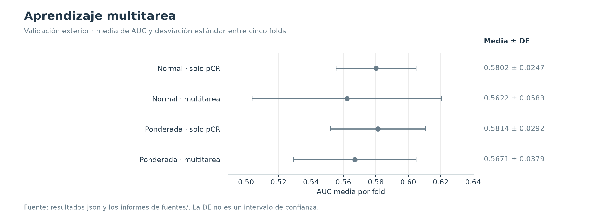
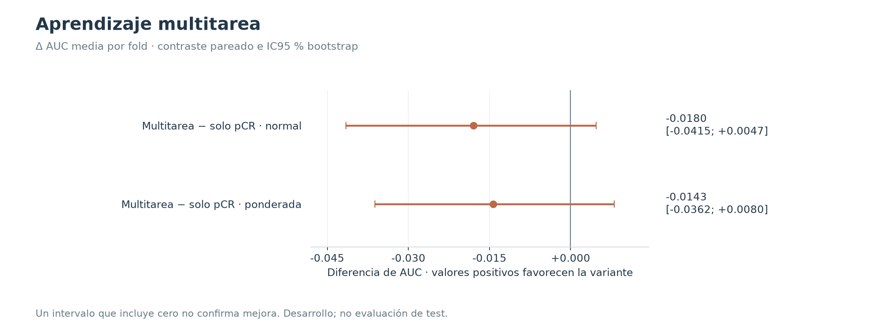

# Aprendizaje multitarea

**26–27/10/2026 · Descartado para el modelo vigente.** Los objetivos auxiliares no aportaron una mejora de pCR.

## Hipótesis y diseño

Predecir HR, HER2 y log-volumen junto a pCR podía regularizar la representación visual. La clínica se usó como etiqueta auxiliar durante entrenamiento, no como entrada de la CNN en inferencia.

Se comparó λ auxiliar = 1 con λ = 0, manteniendo inicialización, roles, orden de lotes y aumentos. Cinco folds, tres semillas (42, 2026, 7), dos pérdidas y dos valores de λ: 60 redes. Las pacientes exteriores quedaron fuera del entrenamiento y de la selección de época.

## Resultados

| Variante | AUC media | DE entre folds | AUC agrupada | Época elegida, mediana |
|---|---:|---:|---:|---:|
| Normal · solo pCR | 0.5802 | 0.0247 | 0.5708 | 5 |
| Normal · multitarea | 0.5622 | 0.0583 | 0.5483 | 10 |
| Ponderada · solo pCR | 0.5814 | 0.0292 | 0.5778 | 4 |
| Ponderada · multitarea | 0.5671 | 0.0379 | 0.5636 | 8 |

La diferencia fue −0,0180 con BCE normal y −0,0143 con ponderada. Los dos IC95 % incluyen cero; el resultado es ausencia de mejora demostrada, no una prueba concluyente de inferioridad en cualquier configuración. Las métricas de HR, HER2 y volumen se conservan en el JSON para examinar qué aprendieron las tareas auxiliares.

## Decisión y límites

Se mantuvo λ = 0 y se continuó con ajustes de entrenamiento. La clínica volvió a incorporarse mediante una logística separada, en la [fusión tardía](../06_fusion_tardia/README.md). Los errores de las gráficas de AUC son **desviaciones estándar entre folds**, no intervalos de confianza. Los intervalos de las diferencias proceden de 2.000 remuestreos pareados del ensayo.

## Evidencia y reproducción

- [Resultados estructurados](resultados.json) y [tabla CSV](metricas.csv), con precisión completa.
- [Procedencia y hashes SHA-256](procedencia.json) de los informes conservados en [fuentes/](fuentes/).
- Las figuras nuevas se regeneran con `python experiments/generar_figuras.py`, desde la raíz del proyecto.
- [Volver al catálogo](../README.md).
