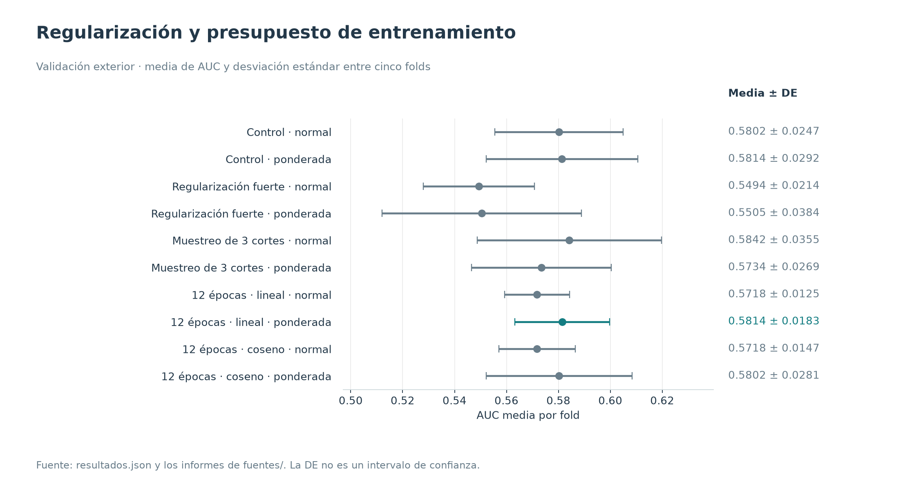
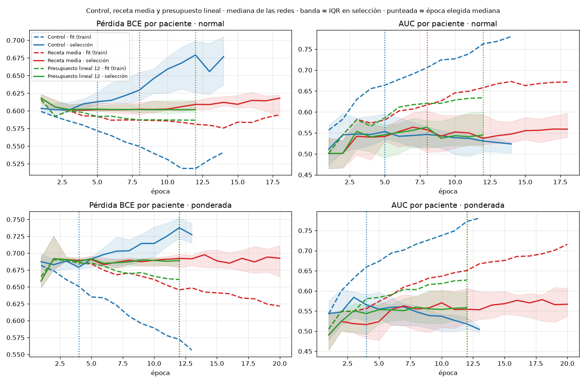

# Regularización y presupuesto de entrenamiento

**26–27/10/2026 · Adoptada la receta lineal de 12 épocas, con BCE ponderada.** Es la base de `imagen_v2`.

## Hipótesis y diseño

El control sobreajustaba pronto. Se compararon cinco recetas, siempre sin auxiliares, con los mismos cinco folds y tres semillas, tanto con BCE normal como ponderada:

1. **Control:** selección de época por AUC interna.
2. **Regularización fuerte:** menor LR, weight decay 0,05, dropout 0,5, cutout y suavizado de etiquetas.
3. **Muestreo de 3 cortes:** tres cortes aleatorios por paciente y época, giro ±10° y EMA 0,98.
4. **Presupuesto lineal:** 12 épocas fijas, LR que decae hasta cero y último checkpoint.
5. **Presupuesto coseno:** mismo presupuesto, con calendario coseno.

Los planes completos están dentro de cada resumen de `fuentes/`. Cada receta aporta 30 redes sin auxiliares; los controles se reutilizan en las comparaciones, no se vuelven a contar como ensayos nuevos.

## Resultados

| Variante | AUC media | DE entre folds | AUC agrupada | Época, mediana | Brecha final, mediana |
|---|---:|---:|---:|---:|---:|
| Control · normal | 0.5802 | 0.0247 | 0.5708 | 5 | — |
| Control · ponderada | 0.5814 | 0.0292 | 0.5778 | 4 | — |
| Regularización fuerte · normal | 0.5494 | 0.0214 | 0.5217 | 12 | 0.0787 |
| Regularización fuerte · ponderada | 0.5505 | 0.0384 | 0.5328 | 12 | 0.0710 |
| Muestreo de 3 cortes · normal | 0.5842 | 0.0355 | 0.5671 | 8 | 0.1444 |
| Muestreo de 3 cortes · ponderada | 0.5734 | 0.0269 | 0.5685 | 12 | 0.1621 |
| 12 épocas · lineal · normal | 0.5718 | 0.0125 | 0.5611 | 12 | 0.0831 |
| 12 épocas · lineal · ponderada | 0.5814 | 0.0183 | 0.5722 | 12 | 0.0936 |
| 12 épocas · coseno · normal | 0.5718 | 0.0147 | 0.5616 | 12 | 0.0392 |
| 12 épocas · coseno · ponderada | 0.5802 | 0.0281 | 0.5714 | 12 | 0.0702 |

La figura de curvas es una copia exacta del informe anterior; las demás se generan a partir de los JSON. Las curvas describen entrenamiento y selección interna, no AUC exterior por época.

## Decisión y límites

La receta media normal dio la mayor estimación puntual (0,5842), pero se eligió presupuesto lineal ponderado (0,5814) por su época fija y menor dispersión entre folds (DE 0,0183 frente a 0,0355). La brecha final mediana fit−selección bajó de 0,144 a 0,094. Esta elección no demuestra que su AUC sea superior.

La comparación pareada lineal ponderada frente a media ponderada fue +0,0080, IC95 % [−0,0108; +0,0275], y no debe confundirse con la comparación frente a media **normal**. El control, las pérdidas y los pacientes de cada contraste se conservan explícitamente en los resúmenes.

Regularizar más redujo la brecha, pero también la AUC estimada. Las sucesivas elecciones sobre el mismo train siguen siendo desarrollo adaptativo. Los puntos y barras representan media ± DE de cinco folds; la DE no es un IC95 %.

El paquete entrenado se encuentra en [imagen_v2](../../reports/modelo_elegido/imagen_v2/). Este archivo documental no requiere volver a entrenarlo.

## Evidencia y reproducción

- [Resultados estructurados](resultados.json) y [tabla CSV](metricas.csv), con precisión completa.
- [Procedencia y hashes SHA-256](procedencia.json) de los informes conservados en [fuentes/](fuentes/).
- Las figuras nuevas se regeneran con `python scripts/generar_figuras_experimentos.py`, desde la raíz del proyecto.
- [Volver al catálogo](../README.md).
