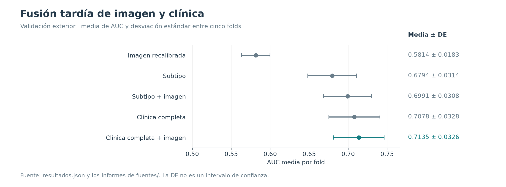
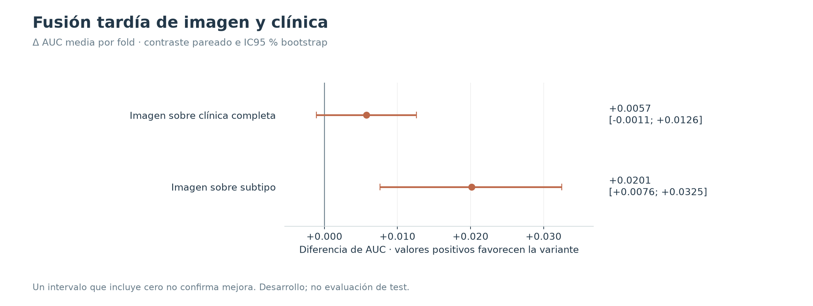

# Fusión tardía de imagen y clínica

**27/10/2026 · Adoptada como `fusion_clinica_v1`.** Combina la CNN congelada con la información clínica disponible.

## Hipótesis y diseño

Una logística separada combina el logit de imagen, edad, log-volumen, HR y HER2. Se evita que una rama clínica entrenada conjuntamente absorba todo el aprendizaje de la CNN. Se usa regularización L2, C = 1 y pérdida normal para la logística; la CNN subyacente utiliza la receta ponderada de 12 épocas.

La evaluación usa cinco folds exteriores. Para ajustar la logística de cada exterior se generan puntuaciones visuales fuera de muestra con cuatro folds interiores y tres semillas: 60 CNN internas. El exterior queda fuera del ajuste de las dos etapas. El [protocolo](../PROTOCOLO_FUSION.md) detalla los roles, la calibración y los contrastes.

## Resultados

| Variante | AUC media | DE entre folds | AUC agrupada | AP agrupada | Brier |
|---|---:|---:|---:|---:|---:|
| Imagen recalibrada | 0.5814 | 0.0183 | 0.5627 | 0.3396 | 0.2066 |
| Subtipo | 0.6794 | 0.0314 | 0.6706 | 0.4287 | 0.1882 |
| Subtipo + imagen | 0.6991 | 0.0308 | 0.6889 | 0.4672 | 0.1876 |
| Clínica completa | 0.7078 | 0.0328 | 0.7062 | 0.4959 | 0.1842 |
| Clínica completa + imagen | 0.7135 | 0.0326 | 0.7109 | 0.5055 | 0.1829 |

La combinación completa alcanzó AUC media 0,7135 frente a 0,7078 de clínica sola. El contraste principal fue +0,00574, IC95 % [−0,00109; +0,01260]: **no confirma una mejora sobre la clínica completa**. Sobre subtipo solo, el contraste pareado fue +0,02014 [0,00760; 0,03247].

Los brazos pueden tener distinta disponibilidad de variables. Los contrastes se calculan sobre las pacientes con predicción en ambos brazos; por eso no siempre coinciden exactamente con restar las medias de toda la tabla. Las barras de la primera figura son DE entre folds; la segunda muestra IC95 % de diferencias pareadas.

## Decisión y límites

Se conserva la combinación por su desempeño conjunto y flexibilidad ante datos incompletos. Hay 15 submodelos por patrón clínico (ocho con imagen y siete solo clínicos), sin imputación; si no hay clínica, se usa la CNN. El paquete vigente está en [fusion_clinica_v1](../../reports/modelo_elegido/fusion_clinica_v1/).

La fila de imagen de esta tabla tiene recalibración logística: su Brier no es el de la CNN cruda de otros informes. La CV anidada evita usar el exterior para ajustar la fusión, pero no elimina el desarrollo adaptativo de la arquitectura y receta. El test del modelo actual sigue sin evaluar; tampoco debe confundirse con el test histórico de otras versiones.

## Evidencia y reproducción

- [Resultados estructurados](resultados.json) y [tabla CSV](metricas.csv), con precisión completa.
- [Procedencia y hashes SHA-256](procedencia.json) de los informes conservados en [fuentes/](fuentes/).
- Las figuras nuevas se regeneran con `python experiments/generar_figuras.py`, desde la raíz del proyecto.
- [Volver al catálogo](../README.md).
