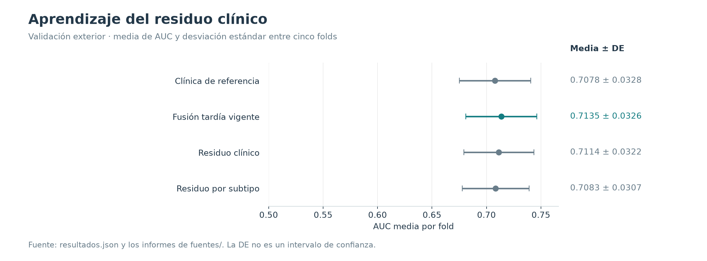
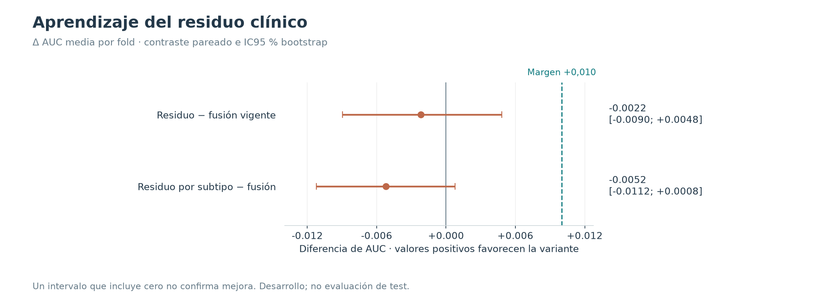

# Aprendizaje del residuo clínico

**27/10/2026 · Descartado.** Ninguno de los dos brazos cumplió el criterio fijado; continúa vigente la fusión tardía.

## Hipótesis y diseño

Entrenar la CNN para explicar lo que la clínica deja sin resolver: `logit = offset clínico fijo + salida de imagen`. Se probaron una salida común y tres cabezas por subtipo con sesgo compartido. El subtipo selecciona la cabeza; no se añade una rama clínica entrenable al tronco visual.

Los offsets de desarrollo se calcularon por ajuste cruzado excluyendo la etiqueta de cada paciente. Para el exterior, la logística usa solo desarrollo. Cinco folds, tres semillas y dos variantes: 30 redes. Se mantuvieron las 12 épocas y el calendario lineal, con BCE normal, como requiere el offset. Véase el [protocolo previo](../PROTOCOLO_OFFSET.md).

## Resultados

| Variante | AUC media | DE entre folds | AUC agrupada | AP agrupada | Brier |
|---|---:|---:|---:|---:|---:|
| Clínica de referencia | 0.7078 | 0.0328 | 0.7062 | 0.4959 | 0.1842 |
| Fusión tardía vigente | 0.7135 | 0.0326 | 0.7109 | 0.5055 | 0.1829 |
| Residuo clínico | 0.7114 | 0.0322 | 0.7106 | 0.5052 | 0.1831 |
| Residuo por subtipo | 0.7083 | 0.0307 | 0.7070 | 0.5061 | 0.1839 |

Frente a la fusión, el residuo común dio ΔAUC −0,00217, IC95 % [−0,00895; +0,00482], y las cabezas por subtipo −0,00521 [−0,01121; +0,00079]. Ambos intervalos incluyen cero.

## Decisión y límites

La adopción exigía **las dos** condiciones: ΔAUC ≥ +0,010 frente a la fusión y un IC95 % de aporte sobre su propio offset clínico que excluyera cero. Ningún brazo cumplió. Sus diferencias frente a clínica sola fueron +0,00356 [−0,00834; +0,01507] y +0,00053 [−0,00767; +0,00873], respectivamente.

El resultado es negativo respecto al criterio de adopción; no demuestra inferioridad universal de los modelos residuales. No se eligió un paquete final nuevo ni se reabrió test. Se conserva [la implementación experimental](../offset.py) para reproducibilidad explícita, junto a las métricas y los resultados por subgrupo del resumen. El grupo de subtipo desconocido es demasiado pequeño para una conclusión útil.

## Evidencia y reproducción

- [Resultados estructurados](resultados.json) y [tabla CSV](metricas.csv), con precisión completa.
- [Procedencia y hashes SHA-256](procedencia.json) de los informes conservados en [fuentes/](fuentes/).
- Las figuras nuevas se regeneran con `python experiments/generar_figuras.py`, desde la raíz del proyecto.
- [Volver al catálogo](../README.md).
